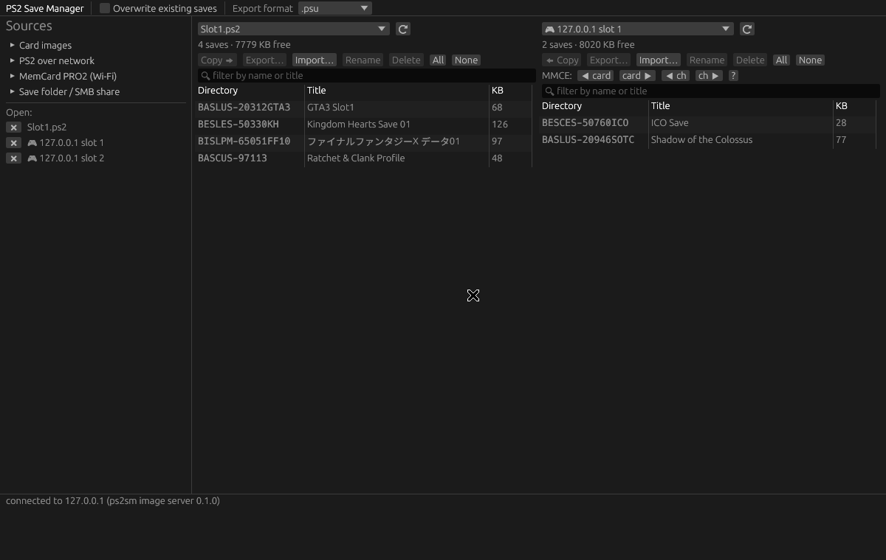

# PS2 Save Manager

Manage PlayStation 2 memory card saves from a PC and from the console
itself: card images (`.ps2`, `.mc2`, `.bin`, `.vmc`), single-save files
(`.psu`, `.max`, `.cbs`, `.sps`/`.xps`), a real PS2 over the network, the
virtual cards on a **MemCard PRO2** over Wi-Fi, and save folders on a
network (SMB) share.

```
┌──────────────── desktop (Rust) ────────────────┐        ┌────── PS2 (C, ps2sdk) ──────┐
│ ps2sm-gui  ─┐                                   │  TCP   │ PS2SM.ELF                   │
│ ps2sm (CLI)─┼─ ps2net ─ PS2SM protocol ─────────┼────────┼─ server ─ libmc ─ mc0:/mc1: │
│             │         └ MemCard PRO2 FTP ───────┼──┐     │ USB backup  (mass:/PS2SM)   │
│             └─ ps2mc (card FS, ECC, formats)    │  │     │ SMB backup  (smb:/PS2SM) ◄─┐│
└─────────────────────────────────────────────────┘  │     │ MMCE card/channel switching ││
                    ▲ folder pane (mounted share) ───┼─────┼─────────────────────────────┘│
                    └────────────────────────────────┘     └──────────────────────────────┘
                                         MemCard PRO2 (.mc2 over FTP)
```

## What's in the box

| Path | What |
|------|------|
| `crates/ps2mc` | Library: PS2 card filesystem (superblock, FAT, directories, per-page ECC, 8–128 MB), `icon.sys`, save formats `.psu` `.max` (LZARI) `.cbs` (RC4+zlib) `.sps`/`.xps` |
| `crates/ps2net` | PS2SM network protocol client + reference server, MemCard PRO2 FTP client |
| `apps/ps2sm-cli` | `ps2sm` command line tool |
| `apps/ps2sm-gui` | `ps2sm-gui` desktop app (egui) — two-pane save manager |
| `ps2/` | `PS2SM.ELF` homebrew for the console (ps2sdk) |
| `docs/PROTOCOL.md` | Wire protocol between desktop and PS2 |

## Desktop app



Two panes side by side. Each pane shows one *source*:

* **Card image** — open `.ps2`/`.mc2`/`.bin`/`.vmc`, or create a new 8 MB card.
  Changes stay in memory until you press **Save** / **Save as…** in the sidebar
  (convert between ECC/no-ECC by choosing `.ps2` or `.bin`).
* **PS2 over network** — start *Network server* in PS2SM on the console, enter
  its IP, **Connect**. Both memory card slots appear as sources. With a MemCard
  PRO2 or SD2PSX in the slot you also get card/channel switching buttons.
* **MemCard PRO2 (Wi-Fi)** — enter host/user/password, **Find cards**, click a
  card (`.mc2` PS2 or `.mcd` PS1) to download it. Edit it like any card image,
  then **Upload to PRO2** (the previous file is kept as `<name>.mc2.bak`).
* **PS1 cards** — `.mcd`/`.mcr`/`.gme`/`.vgs` images open as PS1 sources; PS1
  saves copy between PS1 cards and save folders (as `.mcs`).
* **Save folder / SMB share** — any folder of save files. Point it at the
  mounted share that the PS2 app backs up to, and both sides see the same
  `.psu` files. New saves are written in the format picked under *Export format*.

**To MemCard PRO2…** (in every pane) sends saves to the PRO2 over Wi-Fi:

* **One card per game (Game ID)** — every game gets its own virtual card,
  named after the product code in the save's directory name
  (`BASLUS-20312…` → `/PS2/SLUS-20312/SLUS-20312-1.mc2`; PS1 saves go to
  `/PS1/<ID>/<ID>-1.mcd`), plus a `name.txt` with the title. If the game
  already has a card, the saves are merged into it (existing saves are kept
  unless you tick *Replace*) and the old file is kept as `.bak`. The dialog
  previews every target path first; saves with no product code (e.g.
  `BADATA-SYSTEM`) are listed and skipped.
* **Whole card as one virtual card** — uploads the entire card (a card
  image, a PS2 slot read over the network, a PS1 card, or a folder of saves
  packed into a new card) as `/PS2/<name>/<name>-<channel>.mc2`. An existing
  card is only replaced when you tick *Replace* (kept as `.bak`).

Select saves (click rows), then **Copy ➡ / ⬅ Copy** between panes, **Export…**,
**Import…**, **Rename**, **Delete**. Drag card images or folders onto the window
to open them.

**Exploring a save folder:** double-click a save (or select it and press
**Open**) to see the files inside it. From there you can **Upload files…** into
the folder (or drop files onto the window), **Download…** selected files,
**Rename** or **Delete** files, and export the whole save in any format. This
works on every source: card images, a PS2 over the network, MemCard PRO2 cards
and save files in a folder (the file is rewritten in its own format). Uploading
a file that already exists needs *Replace existing files* ticked. Names must be
31 ASCII characters or fewer.

Japanese titles render if a CJK font is installed (Noto Sans CJK on Linux,
MS Gothic on Windows, Hiragino on macOS).

```
ps2sm-gui [--ps2 192.168.1.50] [card.ps2 ...] [save-folder ...]
```

## CLI

```
ps2sm format new.ps2                       # blank 8 MB card with ECC (--no-ecc, --size 16)
ps2sm info card.ps2
ps2sm saves card.ps2
ps2sm ls card.ps2 BASLUS-20312GTA3
ps2sm export card.ps2 --all -f psu -o backups/
ps2sm import card.ps2 *.psu *.max --overwrite
ps2sm delete card.ps2 BASLUS-20312GTA3
ps2sm rename card.ps2 OLD NEW
ps2sm add card.ps2 BASLUS-20312GTA3 patch.bin readme.txt [--replace]   # upload into a save folder
ps2sm extract card.ps2 BASLUS-20312GTA3 [FILE ...] -o out/             # copy files out
ps2sm rm card.ps2 BASLUS-20312GTA3/patch.bin                           # delete a file in a save
ps2sm show save.max                        # what's inside a save file
ps2sm convert save.max save.psu            # any save format -> any save format
ps2sm convert card.ps2 card.bin            # strip/add ECC
ps2sm check card.ps2 [--fix]               # cross-links, lost clusters, ECC

ps2sm ps2 192.168.1.50 status              # talk to PS2SM on the console
ps2sm ps2 192.168.1.50 saves               # -s 2 for slot 2
ps2sm ps2 192.168.1.50 get BASLUS-20312GTA3 -f max
ps2sm ps2 192.168.1.50 put *.psu
ps2sm ps2 192.168.1.50 ls BASLUS-20312GTA3          # files inside a save on the console
ps2sm ps2 192.168.1.50 add BASLUS-20312GTA3 patch.bin [--replace]
ps2sm ps2 192.168.1.50 extract BASLUS-20312GTA3 -o out/
ps2sm ps2 192.168.1.50 rm BASLUS-20312GTA3/patch.bin
ps2sm ps2 192.168.1.50 dump slot1.ps2      # whole card -> image
ps2sm ps2 192.168.1.50 restore slot1.ps2   # every save in an image -> card
ps2sm ps2 192.168.1.50 mmce next           # MemCard PRO2: next card (prev, card N, channel N)

ps2sm mcp memcardprogc -u admin -p secret cards
ps2sm mcp memcardprogc -u admin -p secret get /PS2/…/…-1.mc2 card.mc2
ps2sm mcp memcardprogc -u admin -p secret put card.mc2 /PS2/…/…-1.mc2
ps2sm mcp memcardprogc -u admin -p secret upload-card slot1.ps2 --name MemoryCard2 [--channel 1] [--replace]
ps2sm mcp memcardprogc -u admin -p secret upload-card --ps2 192.168.1.50 --slot 1 --name PS2Slot1
ps2sm mcp memcardprogc -u admin -p secret per-game slot1.ps2 old-ps1.mcd *.psu [--dry-run] [--overwrite]
ps2sm mcp memcardprogc -u admin -p secret per-game --ps2 192.168.1.50 --slot 1 --only BASLUS-20312GTA3

ps2sm serve card1.ps2 [card2.ps2]          # act like a PS2 (testing / LAN sharing)
```

## PS2 app (PS2SM.ELF)

Menu:

* **Memory card slot 1 / 2** — list saves with titles; per save: back up to
  USB or SMB, copy to the other slot, delete, details. △ backs up all saves to
  USB, □ all to SMB. Offers to format an unformatted card.
* **Network server** — shows the console's IP; leave it open while the
  desktop app works with the cards.
* **Restore from USB / SMB** — pick a `.psu`, pick a slot.
* **MemCard PRO2 / SD2PSX (MMCE)** — current card/channel/GameID per slot;
  L1/R1 previous/next card, L2/R2 previous/next channel.

Backups are plain `.psu` files in `mass:/PS2SM/` and `smb:/<smb_dir>/`, the
same format uLaunchELF/OPL use. Settings come from `PS2SM.CNF` (see
`ps2/PS2SM.CNF.example`) next to the ELF, in `mc0:/PS2SM/`, or `mass:/PS2SM/`.

Networking runs on the IOP stack (DHCP or static), so the SMB client
(`smbman`, SMB1 like OPL) and the server share one connection. Windows 10/11
needs *SMB 1.0/CIFS Server* enabled for the share; Samba needs
`server min protocol = NT1`.

## Building

Desktop (Rust ≥ 1.80):

```
cargo build --release            # target/release/ps2sm and ps2sm-gui
cargo test                       # library, formats, LZARI, protocol loopback
```

Linux needs the usual X11/Wayland dev libraries for the GUI (`libxkbcommon`,
`libgl`). File dialogs use the XDG portal.

PS2 (ps2dev toolchain):

```
cd ps2
docker run --rm -v "$PWD":/src -w /src ps2dev/ps2dev:latest sh -c "apk add make && make"
# or with a local toolchain: export PS2SDK=…; make
```

`ps2/hosttest/` builds the PS2 server code (`net.c`, `mcio.c`, `util.c`) for
Linux with a libmc shim that maps a memory card to a directory, so the
protocol can be tested against the desktop client without a console:

```
make -C ps2/hosttest && mkdir -p /tmp/t/slot1 && CARD_ROOT=/tmp/t ps2/hosttest/ps2sm-host 6524 &
ps2sm ps2 127.0.0.1 put some.psu && ps2sm ps2 127.0.0.1 saves
```

## MemCard PRO2 notes

* Enable the FTP server in the PRO2 WebUI (Settings), set a user/password,
  save, power-cycle. The device allows one plain-FTP connection in passive mode.
* Cards are found by scanning `/PS2`, `/PS1` (and `/MemoryCards` on the
  original MemCard PRO) for `*.mc2` / `*.mcd` (template cards skipped), so
  per-game (GameID) folders and named cards both show up.
* Game ID cards are written as `/PS2/<ID>/<ID>-<channel>.mc2` (8 MB with ECC)
  and `/PS1/<ID>/<ID>-<channel>.mcd` (128 KB), with `name.txt` beside them.
  The PRO2 chooses a game's card from the disc ID it detects. Almost every game
  saves under its own disc ID, but a few (some multi-disc games and budget
  re-releases) use a different one; rename that folder on the SD card if the
  PRO2 doesn't pick it up.
* Don't upload over the card that's currently mounted by a running console:
  switch the PRO2 to another card first, or turn the console off.
* From the PS2 side the app talks to the PRO2 through `mmceman` (MMCE
  protocol), which also works with SD2PSX and other MMCE devices.

## Format notes

* Card images: with ECC (528-byte pages, PCSX2 `.ps2`, MemCard PRO `.mc2`,
  8,650,752 bytes for 8 MB) or without (512-byte pages, 8,388,608 bytes). The
  layout is detected from the file size; ECC is kept up to date on every write.
* `.max` uses LZARI (a port of Okumura's original); `.cbs` is RC4 + zlib.
  Both are read and written. `.sps`/`.xps` writing is best-effort: the trailing
  checksum isn't publicly documented and is written as zero.
* `.max` doesn't store timestamps; saves imported from it get the current time.

## Status

Tested here: library unit tests, format round-trips, card fill/delete/check,
desktop ↔ reference server, desktop ↔ PS2 server code (host build), MemCard
PRO2 client against a local FTP server, and the PS2 ELF compiles with the
current ps2sdk. Not yet tested on real hardware: the PS2 app on a console, a
real MemCard PRO2, and cross-checking card images against PCSX2/mymc.
